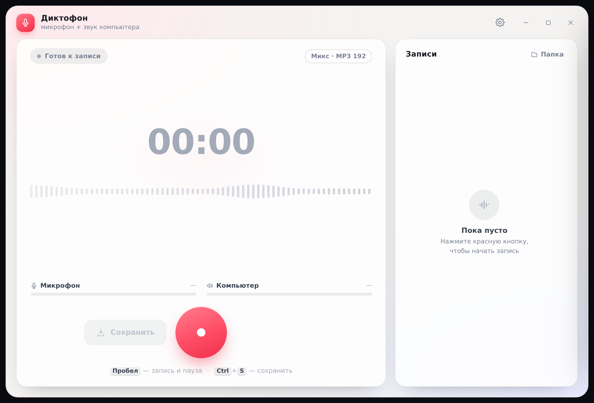
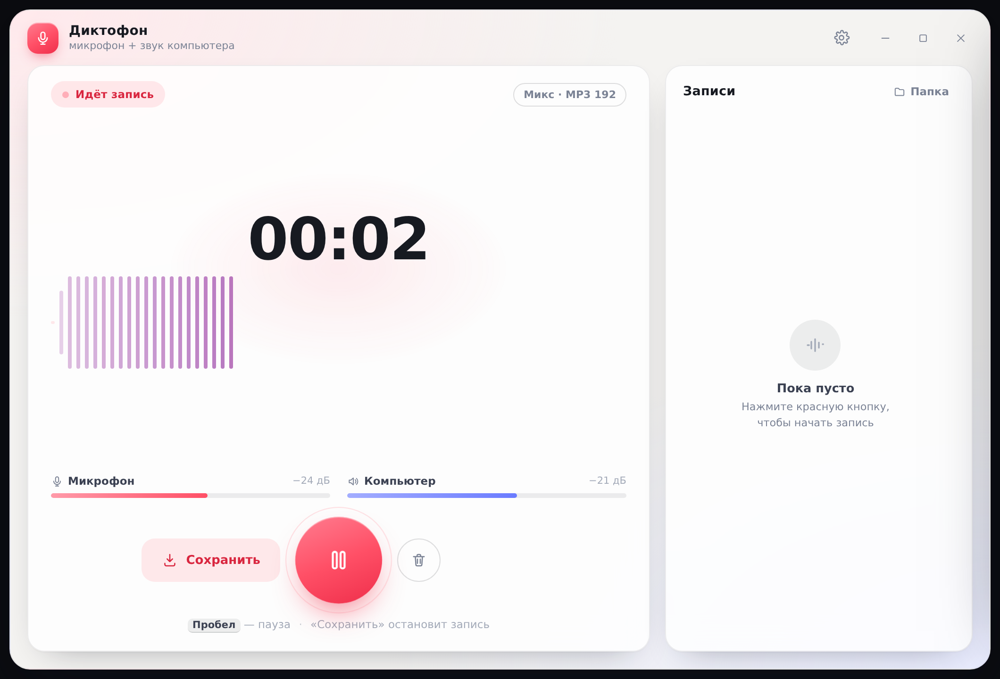
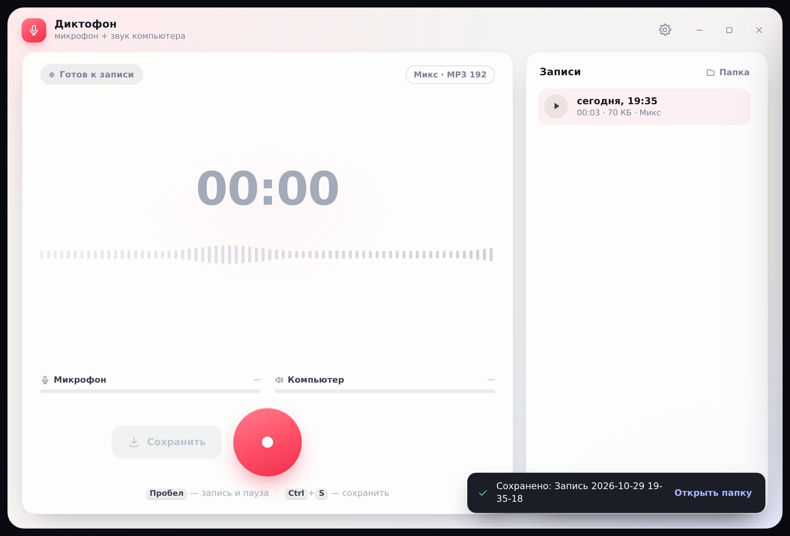
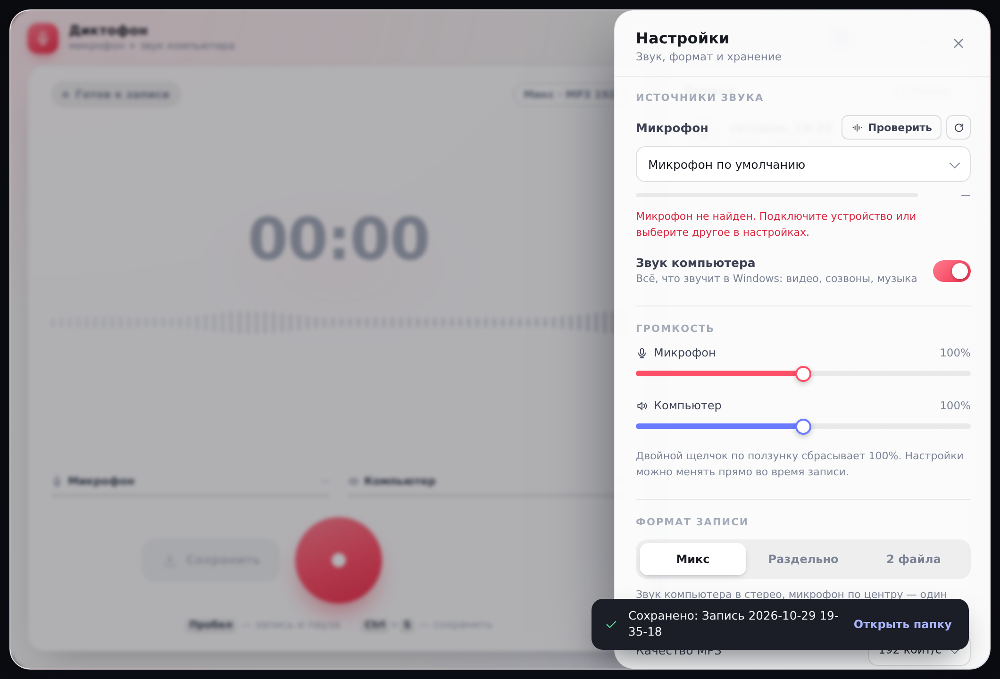
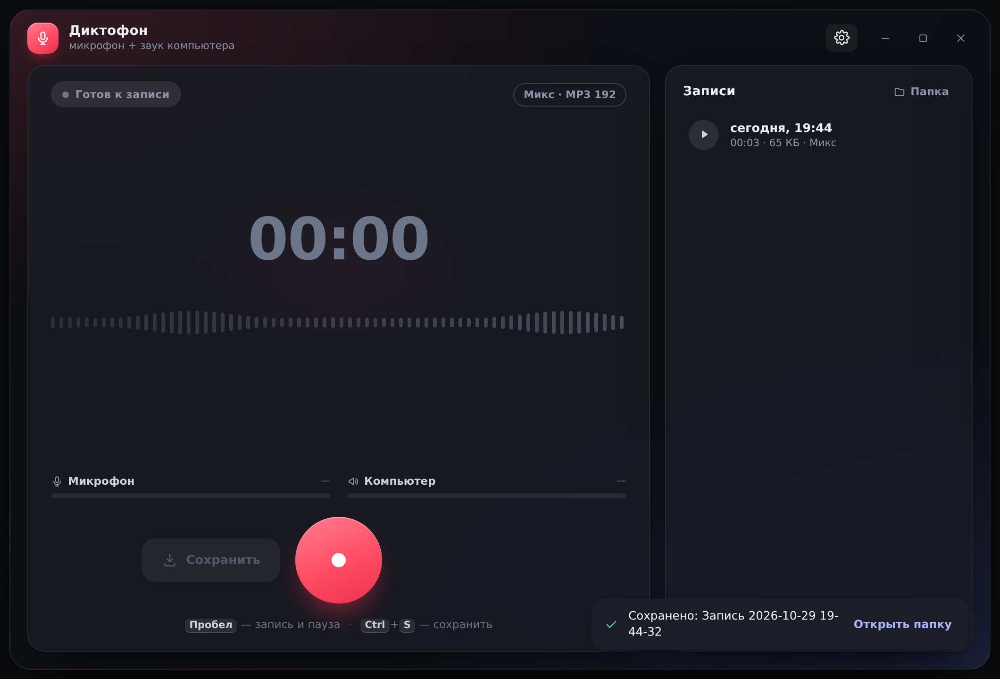

# Диктофон для Windows 10


&nbsp;Простой и аккуратный диктофон: пишет **микрофон** и **весь звук компьютера**
(видео, созвоны, музыка) в MP3. Большая красная кнопка, пауза, сохранение —
и ничего лишнего.

<br clear="left">

## Как это выглядит

| Ожидание | Запись |
| --- | --- |
|  |  |

| Список записей | Настройки |
| --- | --- |
|  |  |

Тёмная тема включается автоматически вместе с Windows (или вручную в
`Параметры → Цвета`):



> Скриншоты сняты в демо-режиме (`npm run preview`) скриптом
> `node scripts/screenshot.mjs`: он же проверяет полный сценарий
> «запись → пауза → сохранение → прослушивание».

## Возможности

- **Запись микрофона + системного звука** одновременно. Системный звук пишется
  через WASAPI loopback — виртуальные кабели не нужны.
- **Пауза и продолжение** без склеек: таймер и файл останавливаются.
- **Сохранение** кнопкой или `Ctrl+S`; файлы сразу попадают в папку с записями.
- **Настройки звука**: выбор микрофона, проверка его уровня, отдельная
  громкость микрофона и компьютера (можно менять прямо во время записи).
- **Три режима**: «Микс» (звук компьютера в стерео + микрофон по центру),
  «Раздельно» (микрофон слева, компьютер справа) и «Две дорожки» (два файла).
- **Качество MP3** 128 / 192 / 320 кбит/с, длительность и размер видно в списке.
- **Список записей** с прослушиванием, прогрессом, удалением в корзину и
  открытием папки.
- **Скруглённое окно** без системной рамки, светлая и тёмная темы
  (подстраивается под Windows), аккуратный интерфейс.
- **Горячие клавиши**: `Пробел` — запись/пауза, `Ctrl+S` — сохранить,
  `Esc` — закрыть настройки.

## Быстрый старт (из исходников)

Нужен [Node.js 18+](https://nodejs.org).

```bash
npm install
npm start
```

Приложение запустится как обычное окно Windows.

## Сборка установщика

```bash
npm run dist
```

В папке `dist` появятся:

- `Dictofon-Setup-1.0.0.exe` — установщик (ярлык «Диктофон» на рабочем столе);
- `Dictofon-Portable-1.0.0.exe` — портативная версия одним файлом, без установки.

Можно собрать только один вариант: `npm run dist:setup` или `npm run dist:portable`.

> Файлы не подписаны, поэтому Windows SmartScreen может предупредить при запуске:
> «Подробнее» → «Выполнить в любом случае».

Готовый установщик также собирается автоматически в GitHub Actions
(вкладка **Actions → Windows build**), если запушить тег `v*` или нажать
«Run workflow». Там же задание `screenshots` делает снимки интерфейса и
проверяет сквозной сценарий «запись → сохранение» в Chromium
(`npm i --no-save playwright`, затем `node scripts/screenshot.mjs`).

## Где лежат записи

- Записи: `Документы\Диктофон` (папку можно изменить в настройках).
- Настройки и список: `%APPDATA%\Dictofon`.
- Пока идёт запись, чанки пишутся во временную папку и удаляются после
  сохранения или отмены.

Имена файлов: `Запись 2026-10-29 19-42-05.mp3`; в режиме «Две дорожки» —
`Запись ... (микрофон).mp3` и `Запись ... (компьютер).mp3`.

## Как записывается звук компьютера

Electron отдаёт окну loopback-поток звуковой карты (WASAPI loopback) — это
именно то, что вы слышите в наушниках или колонках. Поэтому:

- пишется **устройство воспроизведения Windows по умолчанию**;
- если слушаете через колонки, микрофон может дополнительно уловить их звук —
  для чистой записи лучше наушники;
- звук, защищённый DRM, система не отдаёт — это ограничение Windows.

## Горячие клавиши

| Клавиши | Действие |
| --- | --- |
| `Пробел` | начать запись / пауза / продолжить |
| `Ctrl+S` | остановить и сохранить |
| `Esc` | закрыть настройки / отменить удаление |

Кнопка «Сохранить» останавливает запись и сохраняет её одним действием.
Корзина удаляет текущую (ещё не сохранённую) запись — нужно нажать дважды.

## Предпросмотр интерфейса в браузере

```bash
npm run preview
```

Откройте `http://localhost:8080`. Это демо-режим: аудио синтезируется, но
проходит через настоящий MP3-энкодер и тот же интерфейс — удобно посмотреть
дизайн и поведение без Windows.

## Тесты

```bash
npm test
```

- `test/mix.test.mjs` — микширование каналов, громкости, клиппинг;
- `test/encoder.test.mjs` — MP3-энкодер (валидные кадры, размеры, скорость);
- `test/ui.test.mjs` — интерфейс в jsdom: запись → пауза → сохранение,
  список, настройки, горячие клавиши;
- `test/main-process.test.mjs` — главный процесс без Electron (заглушка
  `electron`): чанки на диске, сохранение файлов, имена при совпадении,
  настройки, протокол `app://`, разрешения, закрытие окна;
- `test/util.test.mjs` — форматирование времени, размеров и дат;
- `test/ipc-contract.test.mjs` — каналы preload ↔ main и защита окна.

## Структура проекта

```
src/main.js                 Electron: окно, loopback-захват, файлы, настройки
src/preload.js              безопасный мост window.dictofon
src/renderer/index.html     разметка окна
src/renderer/styles.css     светлая/тёмная тема, скругления, анимации
src/renderer/app.js         логика окна: запись, пауза, сохранение, список
src/renderer/engine.js      захват звука (AudioWorklet) и потоковая запись
src/renderer/capture-worklet.js  AudioWorklet-процессор
src/renderer/encoder-worker.js   воркер MP3-энкодера
src/renderer/encoder.js     обёртка над lamejs
src/renderer/mix.js         режимы микширования
src/renderer/wave.js        визуализация уровня
src/renderer/ui.js          рендер списка, настроек и тостов
src/renderer/preview-shim.js демо-мост для браузера
src/renderer/vendor/        lamejs (LGPL-3.0)
scripts/preview-server.mjs  локальный сервер предпросмотра
scripts/make-icon.mjs       генерация build/icon.ico и icon.png
```

## Ограничения

- Windows 10/11, x64. Системный звук — только Windows/macOS (в Windows 10
  используется WASAPI loopback).
- MP3 (без WAV), без выбора устройства воспроизведения — пишется системное
  по умолчанию.
- Проект учебный и не подписан сертификатом.

## Лицензия

MIT — файл [LICENSE](LICENSE). MP3-энкодер —
[lamejs](https://github.com/zhuker/lamejs) под LGPL-3.0, файл лицензии:
`src/renderer/vendor/lamejs-LICENSE.txt`.
